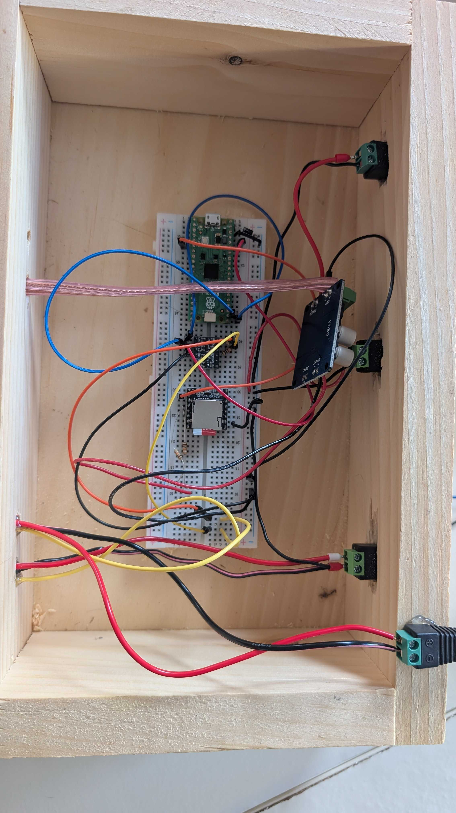
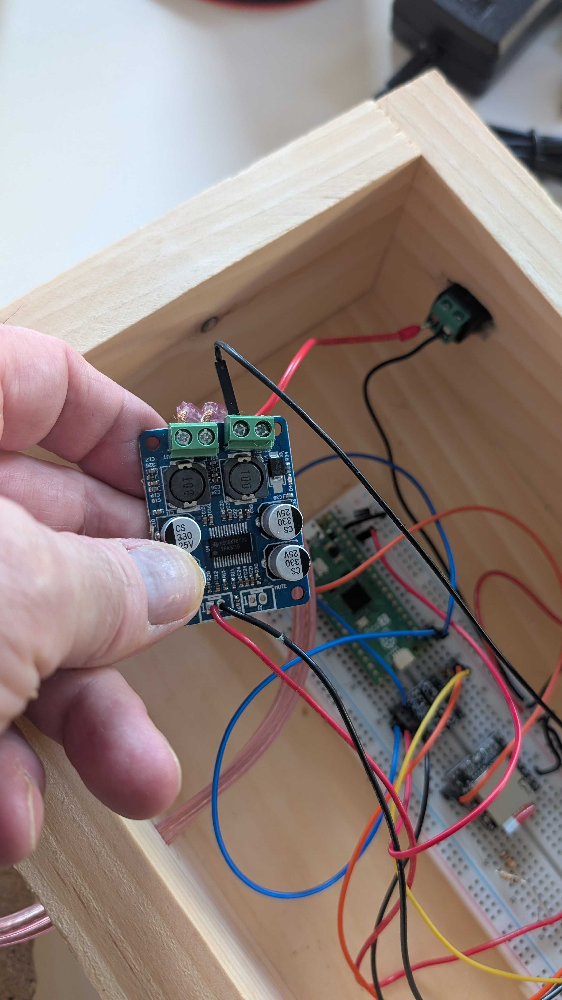
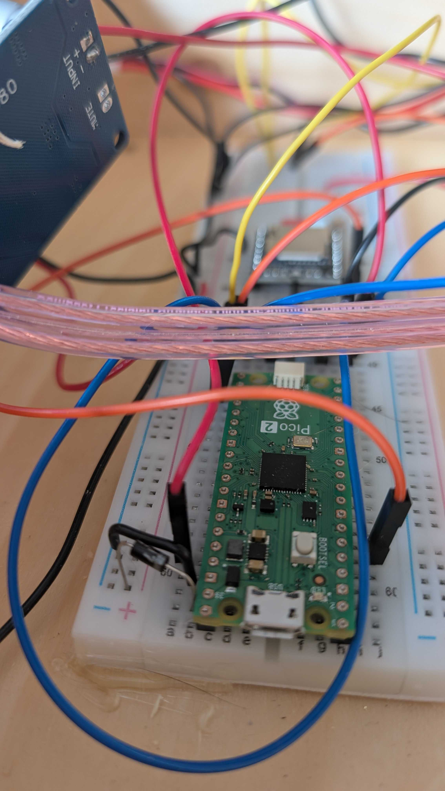

# 2026 Retrospective <!-- omit in toc -->

What happened in the 2026 season, why lightning did not make it, and what 2027 changes first. The design is in the [2026 Blueprint](./2026-blueprint.md); the work was tracked in Paca epic HALL-1 and closed by HALL-11.

## Table of Contents <!-- omit in toc -->

- [1. Outcome](#1-outcome)
- [2. Timeline](#2-timeline)
- [3. What Went Well](#3-what-went-well)
- [4. Why Lightning Did Not Make It](#4-why-lightning-did-not-make-it)
- [5. 2027 Actions](#5-2027-actions)
- [6. Carried-Over Fixes](#6-carried-over-fixes)
- [7. As-Built Photos](#7-as-built-photos)

## 1. Outcome

Halloween 2026 ran **thunder only**, unattended all evening with no restarts. One DFPlayer Mini, the 60 W amplifier and one speaker played a random thunder track every 30 s or so, at volume 25. Even without visual lightning, the thunder added to the display's ambiance.

The planned two rigs of lightning were dropped on 2026-10-31. Rig A's strip showed about 30 pixels of random red, green and blue that stayed lit after each strike: corrupt data on the line. There was no time left to find the cause. The firmware was cut to one rig on a fixed 30 s timer, with its strip disconnected, and that as-run config is what the `2026` tag holds.

## 2. Timeline

| Date       | Event                                                                                                           |
| :--------- | :-------------------------------------------------------------------------------------------------------------- |
| 2026-10-25 | Blueprint and epic HALL-1; repo cleanup (HALL-2)                                                                |
| 2026-10-26 | Two-rig firmware with tested scheduler and Wokwi simulation (HALL-3); MicroPython v1.29.0 (HALL-6)              |
| 2026-10-30 | Wiring design (HALL-4); ASCII diagram (HALL-7); blueprint corrected to the BSS138 board (HALL-8, HALL-9); wired |
| 2026-10-31 | Pico flashed and deployed; DFPlayer fixed; rig A corrupt; switched to thunder only                              |
| 2026-11-02 | Retrospective and season close (HALL-11)                                                                        |

## 3. What Went Well

- **Thunder alone carried the display.** A single shared audio path ([ADR-010](../reference/adr/0010-single-shared-audio-path.md)) was enough to set the mood.
- **Tested firmware worked first time.** The scheduler and DFPlayer frames, tested under host pytest with fakes, ran on the real Pico without a code fix. Cutting to thunder only was a configuration change.
- **The ASCII wiring diagram was readable on the night,** where the WireViz SVG needs a viewer that pans and zooms.

## 4. Why Lightning Did Not Make It

- **The blueprint named the wrong level shifter.** It specified a 74AHCT125, but the reused part was a BSS138 MOSFET board, whose slow rising edge is marginal over 2.7 m ([ADR-013](../reference/adr/0013-reused-bss138-level-shifter.md)). The error surfaced the night before Halloween, when a photo of the board was compared with the docs.
- **Work started too late.** Planning began on 2026-10-25 and the build was wired on 2026-10-30, leaving no slack for debugging.
- **There was no bench test.** HALL-5's full-length bench test never ran, so the data problem was first seen at install.
- **The reused strips were worn.** Strips from previous years had been cut, glued and transported, and their wear made faults hard to isolate.
- **Wiring slips used up the remaining time.** The DFPlayer's VCC jumper was missing (VCC read about 2 V, back-powered through RX), and a 1.5 Ω resistor was nearly fitted in place of a 1.5 kΩ pull-up.

## 5. 2027 Actions

1. **Start in September,** with the bench test complete two weeks before Halloween.
2. **Replace the BSS138 board with an actively driven buffer,** a 74AHCT125 or similar, so data integrity no longer depends on pull-ups ([ADR-013](../reference/adr/0013-reused-bss138-level-shifter.md) consequences).
3. **Make the full-length bench test a gate before any install work:** each data run at its real length, thunder through the amp, and a supply check during a full-white flash.
4. **Buy new LED strips** and retire the worn ones.

## 6. Carried-Over Fixes

Found during the 2026 build and not done (HALL-10, closed as won't do). The 2027 blueprint replaces the level shifter and strips, so check each still applies.

- **Rig data corruption:** never diagnosed. The suspects, in order: level shifter HV unconnected, the 1.5 kΩ pull-ups' value or placement, the strip's ground at pixel 1, the 2.7 m run, and a damaged pixel 1.
- **ASCII diagram twisted pairs:** `═` marks only the data line. Draw each rig's pair as data plus ground, with the ground running from the star ground to the strip's GND at pixel 1.
- **Assembly guide checks:** call out breadboards with split power rails, and add "VCC about 5 V at the DFPlayer and HV about 5 V at the level shifter" to verification.
- **Amplifier power terminal:** clamp bare wire or a ferrule, not a Dupont pin.
- **Firmware config:** restore the two-rig `RIGS` list and 60–120 s intervals in `src/main.py` once the strips work.

## 7. As-Built Photos

The enclosure as it ran on 2026-10-31.

[← Back to Explanation](./README.md)
