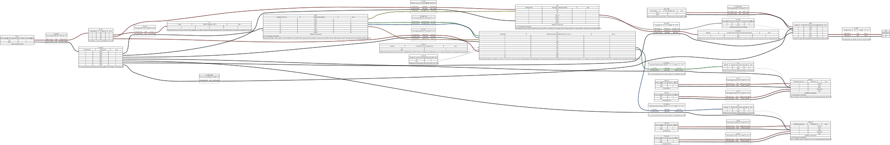
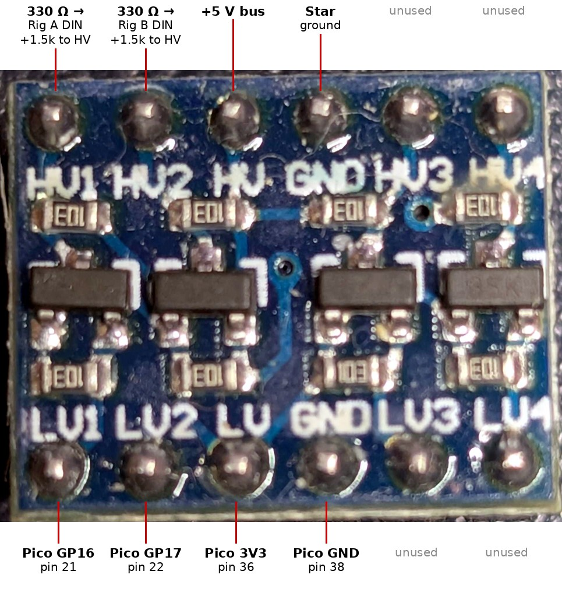

# Assemble the Hardware <!-- omit in toc -->

Wire the 2026 installation: two rigs on one Pico 2, with one DFPlayer Mini, one 60 W amplifier and one speaker in a central enclosure. Part specifications, pin assignments and supply choices are in [Hardware](../reference/hardware.md); the parts list is in the [Bill of Materials](../reference/bill-of-materials.md). The 2026 build fits no fuses and no manual trigger button ([blueprint](../explanation/2026-blueprint.md#41-hardware)).

## Table of Contents <!-- omit in toc -->

- [1. Prerequisites](#1-prerequisites)
- [2. Wiring Diagram](#2-wiring-diagram)
- [3. Steps](#3-steps)
  - [3.1. Logic Rail and Star Ground](#31-logic-rail-and-star-ground)
  - [3.2. Pico 2](#32-pico-2)
  - [3.3. Level Shifter](#33-level-shifter)
  - [3.4. DFPlayer Mini and Amplifier](#34-dfplayer-mini-and-amplifier)
  - [3.5. Rigs](#35-rigs)
- [4. Safety](#4-safety)
- [5. Verification](#5-verification)

## 1. Prerequisites

- Every part in the [Bill of Materials](../reference/bill-of-materials.md).
- The site measured: each strip's pixel 1 must be no more than 2.7 m of cable from the enclosure.
- Soldering iron, multimeter, wire strippers and crimper for ferrules.

## 2. Wiring Diagram

The diagram is the reference for every connection: parts, physical pin numbers, wire colours, gauges and lengths. Where this guide and the diagram disagree, the diagram wins. It is rendered from [`wiring.yml`](../reference/assets/wiring.yml); to change the wiring, edit the YAML and run `npm run wiring`.

The SVG is wide and needs a viewer that pans and zooms. The [Wiring Diagram](../reference/wiring-diagram.md) reference shows the same parts and pins as an ASCII box diagram that reads at a glance.

## 3. Steps

Wire with every supply unplugged.

### 3.1. Logic Rail and Star Ground

1. Mount the 4-way terminal block as the 5 V logic bus and the 8-way block as the star ground.
2. Run the logic supply's positive output to the 5 V bus and its negative to the star ground.
3. Run the 12 V supply's positive output to the amplifier's +12V terminal; run its negative to the amplifier's GND terminal, and a second wire from that terminal to the star ground.

### 3.2. Pico 2

1. Solder the 1N5817 at VSYS (pin 39): cathode (banded end) to VSYS, anode wired to the 5 V bus.
2. Wire GND (pin 38) to the star ground.
3. Leave VBUS (pin 40) unwired. With the diode in place, you can plug a laptop into the Pico's USB while the display is powered.
4. Fit a 100 µF capacitor across VSYS and GND.

### 3.3. Level Shifter

The BSS138 board prints labels, not pin numbers. HV is its 5 V side and LV its 3.3 V side.

1. Wire HV to the 5 V bus, LV to Pico 3V3 (pin 36), and either GND to the star ground.
2. Wire Pico GP16 (pin 21) to LV1 and GP17 (pin 22) to LV2.
3. Solder a 1.5 kΩ resistor across HV1 and HV, and another across HV2 and HV. Without them the board's 10 kΩ pull-ups rise too slowly to drive 2.7 m of cable ([Known Issues](../reference/known-issues.md)).
4. Leave LV3, LV4, HV3 and HV4 unwired.

### 3.4. DFPlayer Mini and Amplifier

1. Wire DFPlayer VCC (pin 1) to the 5 V bus and GND (pin 7) to the star ground, with a 100 µF capacitor across them.
2. Wire Pico GP4 (pin 6, UART1 TX) to DFPlayer RX (pin 2). Leave DFPlayer TX (pin 3) and Pico GP5 unwired.
3. Solder a 10 kΩ resistor to each of the amplifier's IN+ leads. Wire DAC_L (pin 5) to one resistor and DAC_R (pin 4) to the other, so both channels meet at IN+. Wire IN− to the star ground.
4. Leave SPK_1 (pin 6) and SPK_2 (pin 8) unwired: they are the DFPlayer's own 3 W speaker driver, not a line output. The 2025 guide wired the amp from them; 2026 uses DAC_L/DAC_R instead.
5. Wire the amplifier's OUT+ and OUT− to the speaker with 16 AWG cable, observing polarity.
6. Check the amplifier's input terminals against its silkscreen before powering it. The design assumes a mono IN+/IN− input ([ADR-010](../reference/adr/0010-single-shared-audio-path.md)).
7. Insert the MicroSD card prepared in [Prepare Thunder Audio](./prepare-audio.md).

### 3.5. Rigs

Repeat for rig A (level shifter HV1) and rig B (HV2).

1. Cut, or check the strip is already open at, the +5V connection between pixels 150 and 151. Leave GND and data continuous. Each pixel supply then feeds only its own half.
2. Solder a 330 Ω resistor to the strip's DIN pad at pixel 1.
3. Run a twisted 22 AWG pair of no more than 2.7 m from the enclosure: data from the level shifter output to the resistor, ground from the star ground to the strip's GND at pixel 1.
4. Place supply 1 at pixel 1 and wire it with 18 AWG to the strip's +5V and GND at pixel 1, with a 1000 µF capacitor across them.
5. Place supply 2 at pixel 151 and wire it the same way to the +5V and GND at pixel 151. Do not connect data here.

## 4. Safety

Keep the build within the common ground, wire gauges and 12 mA GPIO limit in [Hardware](../reference/hardware.md), and use ferrules on stranded wire in every screw terminal. With no fuses fitted in 2026, each supply's own short-circuit protection is the only guard: check polarity at every strip pad and at the amplifier before power-on, and power one supply at a time.

## 5. Verification

1. With nothing plugged in, check with a meter that every supply's negative, the Pico GND, the DFPlayer GND and each strip's GND at pixels 1 and 151 all read continuity to the star ground.
2. Check that no supply's positive reads continuity to the star ground, and that the +5V at pixel 150 and pixel 151 of each strip read open to each other.
3. Power the logic supply alone and check about 4.7 V at VSYS, 5 V at the level shifter's HV and the DFPlayer, and 3.3 V at its LV.
4. Power everything and follow [Test and Debug](./test-and-debug.md).

[← Back to How-To Guides](./README.md)
