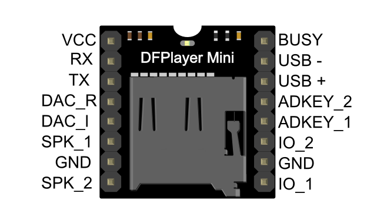

# Hardware <!-- omit in toc -->

Specifications for one 2025 board: components, GPIO pin assignments, power budget and supply choices. Assembly steps are in [Assemble the Hardware](../how-to/assemble-hardware.md); the parts list is in [Bill of Materials](./bill-of-materials.md). The 2026 two-rig changes are in the [2026 blueprint](../explanation/2026-blueprint.md#41-hardware).

## Table of Contents <!-- omit in toc -->

- [1. Components](#1-components)
- [2. Pin Assignments](#2-pin-assignments)
- [3. Power Requirements](#3-power-requirements)
- [4. Power Supplies](#4-power-supplies)
- [5. Multi-Board Deployment](#5-multi-board-deployment)
  - [5.1. Total Power Requirements](#51-total-power-requirements)
  - [5.2. Supply Allocation](#52-supply-allocation)
  - [5.3. Per-Board Power Budget](#53-per-board-power-budget)

## 1. Components

| Component                  | Role                               | Notes                                                                                                                                                                                                                                                                                          |
| :------------------------- | :--------------------------------- | :--------------------------------------------------------------------------------------------------------------------------------------------------------------------------------------------------------------------------------------------------------------------------------------------- |
| Raspberry Pi Pico 2        | Controller                         | RP2350, 520 KB SRAM, MicroPython. [Product page](https://www.raspberrypi.com/products/raspberry-pi-pico-2/), [datasheet](https://datasheets.raspberrypi.com/pico/pico-2-datasheet.pdf), [pinout](./assets/pico-2-pinout.pdf)                                                                   |
| DFPlayer Mini MP3 module   | Thunder playback                   | 9600 baud UART, 16-bit DAC, 44.1 kHz, MicroSD up to 32 GB FAT32. [Universal Solder](https://www.universal-solder.ca/product/mini-mp3-player-module-with-microsd-slot-for-arduino-etc/), [DFRobot wiki](https://wiki.dfrobot.com/DFPlayer_Mini_SKU_DFR0299), [protocol](./dfplayer-protocol.md) |
| 60 W BTL Class D amplifier | Drives the speaker                 | 12 V input. [Amazon](https://www.amazon.ca/dp/B0D8HCV43H)                                                                                                                                                                                                                                      |
| WS2812B NeoPixel strip     | Lightning                          | 300 pixels per board (`LED_COUNT`). [Datasheet](https://cdn-shop.adafruit.com/datasheets/WS2812B.pdf)                                                                                                                                                                                          |
| Logic level shifter        | 3.3 V → 5 V NeoPixel data          | WS2812B data needs 5 V logic for noise margin                                                                                                                                                                                                                                                  |
| 5 V supplies               | Pico, DFPlayer, shifter and pixels | Two per board; see [Power Supplies](#4-power-supplies)                                                                                                                                                                                                                                         |
| 12 V supply                | Amplifier                          | Kept separate from the 5 V logic rail                                                                                                                                                                                                                                                          |

## 2. Pin Assignments

| GPIO Pin | Function       | Direction | Hardware Connection                | Rationale                                                    |
| -------- | -------------- | --------- | ---------------------------------- | ------------------------------------------------------------ |
| **GP16** | NeoPixel Data  | Output    | Level Shifter Input → NeoPixel DIN | Available GPIO, not needed for UART, suitable for PIO timing |
| **GP4**  | MP3 TX         | Output    | Pico TX → DFPlayer Mini RX (Pin 2) | UART1 TX - dedicated hardware UART                           |
| **GP5**  | MP3 RX         | Input     | Pico RX ← DFPlayer Mini TX (Pin 3) | UART1 RX - paired with GP4                                   |
| **GP15** | Manual Trigger | Input     | Button to 3.3V (optional)          | Available GPIO with pull-down support                        |
| **GP25** | Status LED     | Output    | Onboard LED                        | Built-in LED for status indication                           |

**Pin Selection Rationale:**

- **UART1 (GP4/GP5)**: Chosen over UART0 to avoid conflicts with USB serial debugging
- **GPIO 16**: Not required for either UART, suitable for NeoPixel PIO operations
- **GPIO 15**: Readily available for future expansion features
- **All pins verified** against [Pico 2 Datasheet](https://datasheets.raspberrypi.com/pico/pico-2-datasheet.pdf)

Pico GPIO pins source at most 12 mA each; drive nothing heavier than the level shifter or a switch directly.

## 3. Power Requirements

| Component               | Voltage   | Typical Current    | Maximum Current | Notes                                      |
| ----------------------- | --------- | ------------------ | --------------- | ------------------------------------------ |
| **Pico 2**              | 5V (VBUS) | 50-100mA           | 150mA           | Powered via USB or VBUS pin                |
| **DFPlayer Mini**       | 5V        | 20-30mA idle       | 200mA peak      | Use 5V for best performance                |
| **NeoPixels (150)**     | 5V        | 2.5-3A (lightning) | 9A (full white) | Lightning uses ~30% duty cycle per segment |
| **Logic Level Shifter** | 5V + 3.3V | <10mA              | 50mA            | Bidirectional, minimal power               |
| **60W Amplifier**       | 12V       | Variable           | 5A (60W/12V)    | Separate power required                    |

A full-white flash of 300 pixels draws about 18 A in theory; the lightning effect averages about 30 % of that, 5–6 A.

## 4. Power Supplies

**⚠️ CRITICAL: Use Dual 5V Supplies for Reliable NeoPixel Operation**

**Why Two Supplies?**

A single 5V 8A supply powering 300 NeoPixels over 5 meters causes:

- **Voltage drop:** 5.0V at start → 4.2-4.5V at end (below WS2812B spec)
- **Colour shift:** Especially in white/blue
- **Capacity issues:** 6A load on 8A supply = 75% (too close to limit)
- **Thermal stress:** Supply runs hot, reduced reliability

**Solution: Split into Two Segments**

Each 150-pixel segment gets its own supply → eliminates voltage drop, distributes load.

**Power Supply 1: 5V 8A for Logic + Pixels 1-150**

- **Powers:** Raspberry Pi Pico 2, DFPlayer Mini, NeoPixels 1-150, Logic Level Shifter
- **Rating:** 5V 8A (40W)
- **Typical Load:** ~3.2A during lightning effect
- **Load Percentage:** 40% (comfortable headroom)
- **Location:** Start of NeoPixel strip (pixel 1)
- **Recommended:** Mean Well RS-50-5 (5V 10A, 50W) or equivalent
- **Wire Gauge:**
  - 5V to NeoPixels 1-150: 18 AWG
  - 5V to Pico/MP3: 22 AWG sufficient
  - Ground returns: 18 AWG

**Power Supply 2: 5V 8A for Pixels 151-300**

- **Powers:** NeoPixels 151-300 only
- **Rating:** 5V 8A (40W)
- **Typical Load:** ~3A during lightning effect
- **Load Percentage:** 37% (comfortable headroom)
- **Location:** Midpoint of NeoPixel strip (~2.5m, pixel 150)
- **Recommended:** Mean Well RS-50-5 (5V 10A, 50W) or equivalent
- **Wire Gauge:**
  - 5V to NeoPixels 151-300: 18 AWG
  - Ground return: 18 AWG
  - **IMPORTANT:** Do NOT connect data signal here (data flows through from pixel 1)

**Power Supply 3: 12V 5A for Amplifier**

- **Powers:** 60W Class D Amplifier only
- **Rating:** 12V 5A (60W)
- **Typical Load:** Variable by volume
- **Peak Load:** 5A at full power
- **Why Isolated:** Audio amplifiers generate switching noise
- **Recommended:** 12V 5A wall adapter or Mean Well equivalent
- **Ground:** Connect to common ground with 5V supplies
- **Wire Gauge:** 18 AWG adequate

## 5. Multi-Board Deployment

### 5.1. Total Power Requirements

- 6× 5V 8A supplies (2 per board) = 48A at 5V (240W total)
- 3× 12V 5A supplies (1 per board) = 15A at 12V (180W total)
- **Combined: ~420W** for complete installation

### 5.2. Supply Allocation

- Each board has 2× dedicated 5V 8A supplies (one per 150-pixel segment) and 1× dedicated 12V 5A supply (amplifier)
- **Total: 9 power supplies** (6× 5V + 3× 12V)

### 5.3. Per-Board Power Budget

| Board   | Supply 1 (5V 8A)          | Supply 2 (5V 8A) | Supply 3 (12V 5A) | Total Power |
| ------- | ------------------------- | ---------------- | ----------------- | ----------- |
| Board 1 | Pico + MP3 + Pixels 1-150 | Pixels 151-300   | Amplifier         | ~140W       |
| Board 2 | Pico + MP3 + Pixels 1-150 | Pixels 151-300   | Amplifier         | ~140W       |
| Board 3 | Pico + MP3 + Pixels 1-150 | Pixels 151-300   | Amplifier         | ~140W       |

[← Back to Reference](./README.md)
